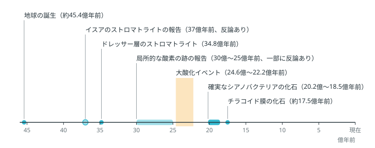
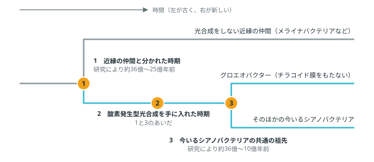
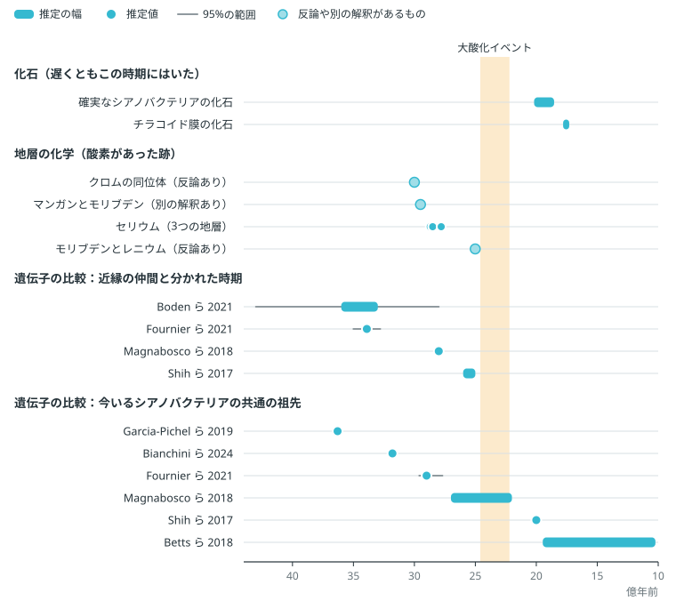

<!-- この原稿は SOL の作業フォルダ（/Users/masa/projects/AMD/SOL/work/amie_cyano_textbook_20261025）で書いた章を、書斎で読むために書き出したもの。直すときは書き出し元の原稿を直し、export_shosai.mjs で書き出し直す。 -->

# 第1章　シアノバクテリアの出現と年代の決め方

> **この章の問い**\
> シアノバクテリアはいつ地球に現れたのか。それはどうやって分かるのか。
>
> **要点**
>
> 1. シアノバクテリアは、水を分解して酸素を出す光合成をする細菌である。今の細菌の中で、この光合成ができるのはシアノバクテリアだけである。
> 2. 出現の時期は、岩に残った化石、地層に残った酸素の跡、今の生き物の遺伝子の比較という3つの方法で調べられている。大気の酸素は約24億5000万年前に増え始めたので、酸素を出す光合成はそれより前に始まっていた。
> 3. 遺伝子の比較による推定は、研究によって10億年以上の幅がある。研究ごとに測っている時点と計算の前提が違うためで、議論が続いている。

## 空気の酸素の始まり

地球の年齢は、約45億4000万年とされる（図1-1）［1］。それから約20億年のあいだ、大気には酸素がほとんどなかった［2］。約40億〜25億年前の地層から推定される大気の酸素は、今の100万分の1にも満たない［2］。今の大気の酸素は、その後、生き物の光合成によって増えてきたものである［3, 4］。

**光合成**は、光のエネルギーを使って、二酸化炭素から体の材料をつくるはたらきである［4, 5］。最初期の光合成生物は、水の代わりに水素や二価の鉄などを使い、酸素を出さなかった［5〜7］。この光合成を**酸素非発生型光合成**と呼ぶ。水を分解して酸素を出す光合成（**酸素発生型光合成**）を始めたのが、シアノバクテリアという細菌の仲間である［3, 4］。今の細菌の中でこの光合成ができるのはシアノバクテリアだけで、植物や藻類の葉緑体も、もとはシアノバクテリアだった（光合成のしくみは第8章、葉緑体は第3章）［3, 8］。

では、シアノバクテリアはいつ現れたのか。この問いに答えた論文の推定を並べると、約36億年前から20億年前より後まで散らばり、幅は10億年を超える（図1-3）。同じ生き物の出現について、なぜこれほど答えが割れるのか。

答えが割れる理由は、手がかりの種類にある。シアノバクテリアの出現の時期は、岩に残った化石、地層に残った酸素の跡、今の生き物の遺伝子の比較という3つの方法で調べられている。3つの方法が示す年代は、そろわない。化石と地層の跡が地球の歴史のどこに残っているかを、図1-1に示す。

**図1-1**　地球の歴史とシアノバクテリアにかかわる出来事。薄い色の印は、反論や再検討があるもの。出典は本文の該当箇所に示す。

## 岩に残った化石

1つ目の手がかりは、化石である。細菌の化石は、顕微鏡でなければ見えない**微化石**として残る。

微化石よりも見つけやすいのが、**ストロマトライト**である。ストロマトライトは、層が積み重なった構造をもつ岩である。水底に広がった微生物の膜（微生物マット）が、泥や砂の粒を捕らえたり鉱物の沈殿を促したりしてできると一般に考えられているが、古いものの多くでは、そのでき方の証拠が残っていない［9］。広く受け入れられている最古級の生命の跡は、西オーストラリアのドレッサー層（約34億8000万年前）にあり、ストロマトライトもここから見つかっている［10, 11］。同じ地域のストレリープール層（約34億3000万年前）のストロマトライトも、生き物がつくった可能性が高いとされる［12］。グリーンランドの37億年前の岩にストロマトライトがあるという2016年の報告に対しては、2018年に、同じ構造を岩の変形でできたものとする反論が出た［11, 13］。2019年には元の研究者たちが岩の変形を調べ直した再検討を出しており、議論は続いている［14］。

ところが、ストロマトライトは、それをつくった微生物がシアノバクテリアだったことまでは必ずしも教えてくれない。酸素非発生型光合成をする細菌や、メタンを使う細菌がかかわってできる場合もあるからである［15］。

微化石なら細胞の形が見えるが、形だけで生き物を見分けるのも難しい。1993年、西オーストラリアの約34億6500万年前の岩から、シアノバクテリアに似た糸状の微化石が報告された［16］。2002年と2015年の再調査は、これらを、熱水の中で鉱物と炭素がつくった、生き物に似た構造と解釈した［17, 18］。2018年には、化石だとする側が、微化石の種類ごとに炭素の同位体の比率が違うという分析を示し、議論は続いている［19］。

確実にシアノバクテリアと言える最古の化石は、カナダのハドソン湾にある地層から見つかったエオエントフィサリス（Eoentophysalis）で、約20億年前から約18億5000万年前のものである［8］。この化石の細胞は3つの方向の面で分裂し、糖がたくさんつながった物質（多糖）の厚い鞘に包まれている［15］。今も潮間帯の泥の上で暮らすシアノバクテリアのエントフィサリス（Entophysalis）と同じ特徴をもつので、シアノバクテリアだと判断できる［15］。

2024年には、さらに踏み込んだ報告が出た。オーストラリアの約17億8000万〜17億3000万年前の地層から見つかった微化石の細胞の中に、**チラコイド膜**の構造が残っていたのである［8］。チラコイド膜は、シアノバクテリアの細胞の中で光合成の反応が進む膜である［8］。この膜が残っていたことは、この生き物が酸素発生型光合成をしていた直接の証拠になる［8］。これは2024年に発表された1つの研究の報告である。

化石が示すのは、「遅くともこの時期にはいた」という年代である。確実なシアノバクテリアの化石は、約20億年前までしかさかのぼれない。一方で、大気の酸素はそれより4億年以上前から増え始めていた［20］。

## 地層に残った酸素の跡

化石が見つからない時代には、2つ目の手がかりとして、酸素そのものが地層に残した跡を使う。酸素が増えると、岩の風化のしかたや海水の成分が変わり、その変化が地層に記録される［21〜23］。研究者は、こうした跡を、酸素発生型光合成がすでに始まっていた証拠として使う［4, 15］。

代表的な手がかりは、硫黄の**同位体**である。同位体は、同じ元素の中で重さだけが違う原子をいう。酸素がほとんどない大気では、太陽の光が大気中の二酸化硫黄を分解するときに、硫黄の同位体が、重さの違いだけでは説明できない比率で分かれる［24, 25］。約24億5000万年前より古い地層には、この比率の偏りが広く見られる［24］。偏りが消えていく時期が、大気に酸素が増えた時期にあたる。

大気の酸素が増えたこの出来事を、**大酸化イベント**と呼ぶ。2017年の研究によると、大酸化イベントは約24億6000万〜24億3000万年前に始まった［20］。始まりを25億年前ごろまで広げる研究もある［26］。その後およそ2億年のあいだ、大気の酸素は増えたり減ったりを繰り返し、約22億2000万年前に定着した［27］。硫黄の同位体の偏りが消える時期も、南アフリカ、北アメリカ、オーストラリアで少しずつずれている［28］。大酸化イベントは、2億年以上かけて進んだ長い変化である。

大酸化イベントより前にも、局所的に酸素があった跡が報告されている。約25億年前の西オーストラリアの泥が固まってできた岩（頁岩）には、陸の岩が酸素で風化したときに海へ運ばれる金属（モリブデンなど）が濃くたまっていた［21］。約30億年前のクロムの同位体［22］、約29億5000万年以上前のマンガンとモリブデン［29］、約28億7000万〜27億8000万年前のセリウム［23］からも、海や大気の一部に酸素があったという報告がある。

このうち、25億年前の頁岩と30億年前のクロムの報告には反論が出ている。25億年前の頁岩については、金属は地層ができたあとにしみこんだ液体で運ばれたとする2022年の再調査があり［30］、元の研究者たちがこれに反論し、再調査をした研究者たちも応答している［31, 32］。30億年前のクロムについては、そのうち鉄鉱層の結果に対して、同じ地層を掘って取り出した試料に同じ信号がなく、現代の風化によるものだとする反論がある［33］。マンガンの酸化は、酸素がなくても起こりうる。約24億年前のマンガン酸化物が酸素を使わずにできたことを示した研究がある［34］。セリウムの報告は、2025年に発表された1つの研究である［23］。

地層の化学には、間違いがあとから分かった例もある。1999年、西オーストラリアの27億年前の岩から、シアノバクテリアに特有とされた分子の化石が見つかったと報告された［35］。報告した研究者たちは、酸素発生型光合成が大気に酸素が増えるずっと前に始まっていたと結論した［35］。ところが2008年、この分子は、岩が約22億年前に強い熱を受けたあとに入り込んだもので、27億年前の生き物の証拠にはならないことが分かった［36］。2015年には、汚れが入らないよう徹底して管理した方法で掘り直した岩から、その分子はほとんど検出されなかった［37］。さらに、この分子は酸素非発生型光合成をする細菌などもつくることが分かり、シアノバクテリアの目印には使えないことも示された［38, 39］。古い岩は長い時間をかけて熱や水にさらされるので、もとからあった痕跡と、あとから入り込んだ物質やよく似た非生物の構造とを見分けるのが難しい［40］。

## 遺伝子から時間をさかのぼる方法

化石も地層の跡も決め手にならない時代に迫る3つ目の方法が、今の生き物の遺伝子の比較である。生き物の遺伝子は、親から子へ受け継がれるあいだに少しずつ変わっていく。共通の祖先から枝分かれしてきた生き物のまとまりを**系統**と呼ぶ。2つの系統が分かれてから時間がたつほど、両者の遺伝子の違いは大きくなる。この違いの量から、系統が分かれた時期を計算する方法を**分子時計**と呼ぶ［15, 41］。違いの量を年代に直すときには、年代の分かっている化石などを使って目盛りを合わせる［15, 41］。

遺伝子の比較は、シアノバクテリアの近縁の仲間についても新しいことを明らかにした。シアノバクテリアには、光合成をしない近縁の仲間がいる［42, 43］。2013年にヒトの腸や地下水のDNAから見つかったメライナバクテリアなどで、これらの細菌がもつ遺伝子の中には、光合成の装置をつくる遺伝子がない［42, 43］（注1）。2017年の研究は、光合成をする今のシアノバクテリアの祖先が、これらの仲間と分かれたあとに光合成の遺伝子を手に入れたと結論した［43］。

このため、「シアノバクテリアが現れた時期」には、少なくとも3つの意味がある（図1-2）。

1. シアノバクテリアの系統が、光合成をしない近縁の仲間と分かれた時期
2. その系統が、酸素発生型光合成を手に入れた時期
3. 今いるシアノバクテリアの共通の祖先が生きていた時期

2021年の研究は、今いるシアノバクテリアの共通の祖先がすでに酸素発生型光合成をしていたとみる［41］。この見方に立つと、2つめの時期は1つめより新しく、3つめと同じかそれより古い［41, 43］。

**図1-2**　「シアノバクテリアが現れた時期」の3つの意味。年代は図1-3の研究の推定値の範囲。

研究ごとの推定は、図1-3のように大きく散らばる。1つめの時期の推定は、2021年の2つの研究で約36億〜33億年前［41, 44］、2018年の研究で約28億年前［45］、2017年の研究で約26億〜25億年前［46］と分かれる。3つめの時期の推定は、約36億年前［47］、約32億年前［48］、約29億年前［41］、約27億〜22億年前［45］、約20億年前［46］、約19億5000万〜10億2000万年前［49］と、さらに大きく分かれる。

**図1-3**　証拠の種類ごとに見た年代の推定。棒は推定の幅、点は1つの推定値。オレンジの帯は大酸化イベント（始まりから定着まで）。薄い色の点は、反論や別の解釈があるもの。マンガンとモリブデンの点は、その年代かそれより古い時期を示す。

推定がこれほど分かれる理由として、研究者自身がいくつかの要因を挙げている。どの化石で目盛りを合わせるか、遺伝子が変わる速さをどういう式で表すか、どの生き物のどの遺伝子を比べるかによって、結果が大きく変わる［41, 44］。2021年の研究では、遺伝子が変わる速さを表す式の選び方を変えるだけで、共通の祖先の年代の推定に、化石で目盛りを合わせない場合で約11億年、最も多くの化石を使った場合でも約9億年の幅が出た［41］。細菌の遺伝子は、別の系統の細菌へ移ることもある（遺伝子の水平伝播）。同じ研究は、遺伝子が移った跡から分かる系統の前後関係を計算に加え、共通の祖先の年代を約29億年前（95%の確からしさで約29億6000万〜27億7000万年前）まで絞り込んだ［41］。目盛り合わせに使える確実なシアノバクテリアの化石が少ないことも、幅を広げる原因の1つである［15］。

## 酸素が増えるまでの時間差

遺伝子の比較の早い推定が正しければ、シアノバクテリアが現れてから大気に酸素が増えるまで、数億年から10億年ほどかかったことになる。酸素をつくる生き物がいたのに、なぜ酸素はすぐに増えなかったのか。

早い出現を認める立場は、つくられた酸素が、海水に溶けていた鉄や火山から出る気体と反応して消費され続けたと説明する［50, 51］。酸素の消費が生産を上回っているあいだは、酸素は大気にたまらない。海の栄養（リン）が少なく、光合成の量そのものが抑えられていたという見方もある［52］。2025年のモデル計算では、酸素発生型光合成が早く始まった場合ほど、大酸化イベントまでの遅れが長くなった。遅れの長さを最終的に左右する要因は、生き物が利用できるリンの量だった［53］。

これに対して、酸素発生型光合成は大酸化イベントの少し前に始まったとする立場がある［4, 54］。2016年のモデル計算では、酸素発生型光合成が始まると、生き物がつくる有機物の量がふつうの想定よりずっと少なくない限り、酸素は約10万年で海や大気の物質による消費を上回った［50］。2017年の分子時計の研究も、その結果は、酸素発生型光合成が大気の酸素の上昇に比較的近い時期に生まれたという考えと合うとした［46］。この立場では、出現から大酸化イベントまでの時間差はほとんどない。

2019年と2021年の遺伝子の比較の研究は、大酸化イベントより数億年以上前に酸素発生型光合成があったとする［41, 47］。大酸化イベントより前の小さな酸素の上昇まで含めて、大酸化イベントをもっと長い変化の頂点とみる総説もある［55］。どちらの立場が正しいかは、まだ決まっていない。

推定が散らばる理由は2つある。1つは、3つの方法がそれぞれ別の時点を測っていることである。化石は「遅くともこの時期にはいた」という年代を示し、確実なものは約20億年前までしかさかのぼれない。地層の化学は、酸素の生産が消費を上回ってたまった時期を示すので、酸素をつくる生き物が現れた時期より新しくなりうる。遺伝子の比較は、近縁の仲間と分かれた時期や共通の祖先の時期を示す。

もう1つは、遺伝子の比較の中でも、目盛りの合わせ方と計算の前提によって結果が大きく動くことである。遺伝子の比較だけで、共通の祖先の推定は約36億年前から約10億年前まで散らばっている。

## 分かっていることと、議論が続いていること

| 項目 | 分かっていること | 議論が続いていること |
|---|---|---|
| 最古の生命 | 微生物は少なくとも約34億年前にいた［10, 12, 40］ | 34億年前より古い痕跡とされる報告（グリーンランドの37億年前のストロマトライトなど）が生命の跡かどうか［11, 13, 14, 40］ |
| 化石 | 確実なシアノバクテリアの化石は約20億〜18億5000万年前から見つかる［8, 15］ | ストロマトライトや形の似た微化石をつくった生き物［15］ |
| 大気の酸素 | 約24億6000万〜24億3000万年前に増え始め、約22億2000万年前に定着した［20, 27］ | それより前に局所的な酸素があったか（約30億〜25億年前の報告）［21, 22, 30, 33］ |
| 分子の化石 | 27億年前の岩の分子の化石は、あとから入り込んだものだった［36, 37］ | なし |
| 遺伝子の比較 | シアノバクテリアには、光合成をしない近縁の仲間がいる［42, 43］ | 近縁の仲間と分かれた時期、光合成を手に入れた時期、共通の祖先の時期［41, 44, 46, 49］ |
| 時間差 | 酸素がたまるには、生産が消費を上回る必要がある［50］ | 酸素がすぐに増えなかった理由と、出現が大酸化イベントの直前だった可能性［50, 52, 53］ |

約24億5000万年前から酸素がたまり始めた地球では、何が変わったのだろうか。

## 注

1. 研究によっては、メライナバクテリアなどの光合成をしない仲間もシアノバクテリアに含め、光合成をするグループをオキシフォトバクテリアと呼び分ける［42, 43］。この教材では、光合成をするグループをシアノバクテリアと呼ぶ。

## 出典

1. Dalrymple GB（2001）The age of the Earth in the twentieth century: a problem (mostly) solved. Geological Society, London, Special Publications 190(1): 205-221. https://doi.org/10.1144/gsl.sp.2001.190.01.14
2. Catling DC, Zahnle KJ（2020）The Archean atmosphere. Science Advances 6(9): eaax1420. https://doi.org/10.1126/sciadv.aax1420
3. Sánchez-Baracaldo P, Bianchini G, Wilson JD ほか（2022）Cyanobacteria and biogeochemical cycles through Earth history. Trends in Microbiology 30(2): 143-157. https://doi.org/10.1016/j.tim.2021.05.008
4. Fischer WW, Hemp J, Johnson JE（2016）Evolution of Oxygenic Photosynthesis. Annual Review of Earth and Planetary Sciences 44(1): 647-683. https://doi.org/10.1146/annurev-earth-060313-054810
5. Hohmann-Marriott MF, Blankenship RE（2011）Evolution of Photosynthesis. Annual Review of Plant Biology 62(1): 515-548. https://doi.org/10.1146/annurev-arplant-042110-103811
6. Olson JM, Blankenship RE（2004）Thinking About the Evolution of Photosynthesis. Photosynthesis Research 80(1-3): 373-386. https://doi.org/10.1023/b:pres.0000030457.06495.83
7. Canfield DE, Rosing MT, Bjerrum C（2006）Early anaerobic metabolisms. Philosophical Transactions of the Royal Society B: Biological Sciences 361(1474): 1819-1836. https://doi.org/10.1098/rstb.2006.1906
8. Demoulin CF, Lara YJ, Lambion A ほか（2024）Oldest thylakoids in fossil cells directly evidence oxygenic photosynthesis. Nature 625(7995): 529-534. https://doi.org/10.1038/s41586-023-06896-7
9. Grotzinger JP, Knoll AH（1999）STROMATOLITES IN PRECAMBRIAN CARBONATES: Evolutionary Mileposts or Environmental Dipsticks? Annual Review of Earth and Planetary Sciences 27(1): 313-358. https://doi.org/10.1146/annurev.earth.27.1.313
10. Djokic T, Van Kranendonk MJ, Campbell KA ほか（2017）Earliest signs of life on land preserved in ca. 3.5 Ga hot spring deposits. Nature Communications 8(1): 15263. https://doi.org/10.1038/ncomms15263
11. Nutman AP, Bennett VC, Friend CRL ほか（2016）Rapid emergence of life shown by discovery of 3,700-million-year-old microbial structures. Nature 537(7621): 535-538. https://doi.org/10.1038/nature19355
12. Allwood AC, Walter MR, Kamber BS ほか（2006）Stromatolite reef from the Early Archaean era of Australia. Nature 441(7094): 714-718. https://doi.org/10.1038/nature04764
13. Allwood AC, Rosing MT, Flannery DT ほか（2018）Reassessing evidence of life in 3,700-million-year-old rocks of Greenland. Nature 563(7730): 241-244. https://doi.org/10.1038/s41586-018-0610-4
14. Nutman AP, Bennett VC, Friend CRL ほか（2019）Cross-examining Earth’s oldest stromatolites: Seeing through the effects of heterogeneous deformation, metamorphism and metasomatism affecting Isua (Greenland) ∼3700 Ma sedimentary rocks. Precambrian Research 331: 105347. https://doi.org/10.1016/j.precamres.2019.105347
15. Demoulin CF, Lara YJ, Cornet L ほか（2019）Cyanobacteria evolution: Insight from the fossil record. Free Radical Biology and Medicine 140: 206-223. https://doi.org/10.1016/j.freeradbiomed.2019.05.007
16. Schopf JW（1993）Microfossils of the Early Archean Apex Chert: New Evidence of the Antiquity of Life. Science 260(5108): 640-646. https://doi.org/10.1126/science.260.5108.640
17. Brasier MD, Green OR, Jephcoat AP ほか（2002）Questioning the evidence for Earth's oldest fossils. Nature 416(6876): 76-81. https://doi.org/10.1038/416076a
18. Brasier MD, Antcliffe J, Saunders M ほか（2015）Changing the picture of Earth's earliest fossils (3.5–1.9 Ga) with new approaches and new discoveries. Proceedings of the National Academy of Sciences 112(16): 4859-4864. https://doi.org/10.1073/pnas.1405338111
19. Schopf JW, Kitajima K, Spicuzza MJ ほか（2018）SIMS analyses of the oldest known assemblage of microfossils document their taxon-correlated carbon isotope compositions. Proceedings of the National Academy of Sciences 115(1): 53-58. https://doi.org/10.1073/pnas.1718063115
20. Gumsley AP, Chamberlain KR, Bleeker W ほか（2017）Timing and tempo of the Great Oxidation Event. Proceedings of the National Academy of Sciences 114(8): 1811-1816. https://doi.org/10.1073/pnas.1608824114
21. Anbar AD, Duan Y, Lyons TW ほか（2007）A Whiff of Oxygen Before the Great Oxidation Event? Science 317(5846): 1903-1906. https://doi.org/10.1126/science.1140325
22. Crowe SA, Døssing LN, Beukes NJ ほか（2013）Atmospheric oxygenation three billion years ago. Nature 501(7468): 535-538. https://doi.org/10.1038/nature12426
23. Patry LA, Bonnand P, Boyet M ほか（2025）Dating the evolution of oxygenic photosynthesis using La-Ce geochronology. Nature 642(8066): 99-104. https://doi.org/10.1038/s41586-025-09009-8
24. Farquhar J, Bao H, Thiemens M（2000）Atmospheric Influence of Earth's Earliest Sulfur Cycle. Science 289(5480): 756-758. https://doi.org/10.1126/science.289.5480.756
25. Pavlov AA, Kasting JF（2002）Mass-Independent Fractionation of Sulfur Isotopes in Archean Sediments: Strong Evidence for an Anoxic Archean Atmosphere. Astrobiology 2(1): 27-41. https://doi.org/10.1089/153110702753621321
26. Warke MR, Di Rocco T, Zerkle AL ほか（2020）The Great Oxidation Event preceded a Paleoproterozoic “snowball Earth”. Proceedings of the National Academy of Sciences 117(24): 13314-13320. https://doi.org/10.1073/pnas.2003090117
27. Poulton SW, Bekker A, Cumming VM ほか（2021）A 200-million-year delay in permanent atmospheric oxygenation. Nature 592(7853): 232-236. https://doi.org/10.1038/s41586-021-03393-7
28. Philippot P, Ávila JN, Killingsworth BA ほか（2018）Globally asynchronous sulphur isotope signals require re-definition of the Great Oxidation Event. Nature Communications 9(1): 2245. https://doi.org/10.1038/s41467-018-04621-x
29. Planavsky NJ, Asael D, Hofmann A ほか（2014）Evidence for oxygenic photosynthesis half a billion years before the Great Oxidation Event. Nature Geoscience 7(4): 283-286. https://doi.org/10.1038/ngeo2122
30. Slotznick SP, Johnson JE, Rasmussen B ほか（2022）Reexamination of 2.5-Ga “whiff” of oxygen interval points to anoxic ocean before GOE. Science Advances 8(1): eabj7190. https://doi.org/10.1126/sciadv.abj7190
31. Anbar AD, Buick R, Gordon GW ほか（2023）Technical comment on “Reexamination of 2.5-Ga ‘whiff’ of oxygen interval points to anoxic ocean before GOE”. Science Advances 9(14): eabq3736. https://doi.org/10.1126/sciadv.abq3736
32. Slotznick SP, Johnson JE, Rasmussen B ほか（2023）Response to comment on “Reexamination of 2.5-Ga ‘whiff’ of oxygen interval points to anoxic ocean before GOE”. Science Advances 9(14): eadg1530. https://doi.org/10.1126/sciadv.adg1530
33. Albut G, Babechuk MG, Kleinhanns IC ほか（2018）Modern rather than Mesoarchaean oxidative weathering responsible for the heavy stable Cr isotopic signatures of the 2.95 Ga old Ijzermijn iron formation (South Africa). Geochimica et Cosmochimica Acta 228: 157-189. https://doi.org/10.1016/j.gca.2018.02.034
34. Johnson JE, Webb SM, Thomas K ほか（2013）Manganese-oxidizing photosynthesis before the rise of cyanobacteria. Proceedings of the National Academy of Sciences 110(28): 11238-11243. https://doi.org/10.1073/pnas.1305530110
35. Brocks JJ, Logan GA, Buick R ほか（1999）Archean Molecular Fossils and the Early Rise of Eukaryotes. Science 285(5430): 1033-1036. https://doi.org/10.1126/science.285.5430.1033
36. Rasmussen B, Fletcher IR, Brocks JJ ほか（2008）Reassessing the first appearance of eukaryotes and cyanobacteria. Nature 455(7216): 1101-1104. https://doi.org/10.1038/nature07381
37. French KL, Hallmann C, Hope JM ほか（2015）Reappraisal of hydrocarbon biomarkers in Archean rocks. Proceedings of the National Academy of Sciences 112(19): 5915-5920. https://doi.org/10.1073/pnas.1419563112
38. Rashby SE, Sessions AL, Summons RE ほか（2007）Biosynthesis of 2-methylbacteriohopanepolyols by an anoxygenic phototroph. Proceedings of the National Academy of Sciences 104(38): 15099-15104. https://doi.org/10.1073/pnas.0704912104
39. Welander PV, Coleman ML, Sessions AL ほか（2010）Identification of a methylase required for 2-methylhopanoid production and implications for the interpretation of sedimentary hopanes. Proceedings of the National Academy of Sciences 107(19): 8537-8542. https://doi.org/10.1073/pnas.0912949107
40. Javaux EJ（2019）Challenges in evidencing the earliest traces of life. Nature 572(7770): 451-460. https://doi.org/10.1038/s41586-019-1436-4
41. Fournier GP, Moore KR, Rangel LT ほか（2021）The Archean origin of oxygenic photosynthesis and extant cyanobacterial lineages. Proceedings of the Royal Society B: Biological Sciences 288(1959): 20210675. https://doi.org/10.1098/rspb.2021.0675
42. Di Rienzi SC, Sharon I, Wrighton KC ほか（2013）The human gut and groundwater harbor non-photosynthetic bacteria belonging to a new candidate phylum sibling to Cyanobacteria. eLife 2: e01102. https://doi.org/10.7554/elife.01102
43. Soo RM, Hemp J, Parks DH ほか（2017）On the origins of oxygenic photosynthesis and aerobic respiration in Cyanobacteria. Science 355(6332): 1436-1440. https://doi.org/10.1126/science.aal3794
44. Boden JS, Konhauser KO, Robbins LJ ほか（2021）Timing the evolution of antioxidant enzymes in cyanobacteria. Nature Communications 12(1): 4742. https://doi.org/10.1038/s41467-021-24396-y
45. Magnabosco C, Moore KR, Wolfe JM ほか（2018）Dating phototrophic microbial lineages with reticulate gene histories. Geobiology 16(2): 179-189. https://doi.org/10.1111/gbi.12273
46. Shih PM, Hemp J, Ward LM ほか（2017）Crown group Oxyphotobacteria postdate the rise of oxygen. Geobiology 15(1): 19-29. https://doi.org/10.1111/gbi.12200
47. Garcia-Pichel F, Lombard J, Soule T ほか（2019）Timing the Evolutionary Advent of Cyanobacteria and the Later Great Oxidation Event Using Gene Phylogenies of a Sunscreen. mBio 10(3): e00561-19. https://doi.org/10.1128/mbio.00561-19
48. Bianchini G, Hagemann M, Sánchez-Baracaldo P（2024）Stochastic Character Mapping, Bayesian Model Selection, and Biosynthetic Pathways Shed New Light on the Evolution of Habitat Preference in Cyanobacteria. Systematic Biology 73(4): 644-665. https://doi.org/10.1093/sysbio/syae025
49. Betts HC, Puttick MN, Clark JW ほか（2018）Integrated genomic and fossil evidence illuminates life’s early evolution and eukaryote origin. Nature Ecology & Evolution 2(10): 1556-1562. https://doi.org/10.1038/s41559-018-0644-x
50. Ward LM, Kirschvink JL, Fischer WW（2016）Timescales of Oxygenation Following the Evolution of Oxygenic Photosynthesis. Origins of Life and Evolution of Biospheres 46(1): 51-65. https://doi.org/10.1007/s11084-015-9460-3
51. Gaillard F, Scaillet B, Arndt NT（2011）Atmospheric oxygenation caused by a change in volcanic degassing pressure. Nature 478(7368): 229-232. https://doi.org/10.1038/nature10460
52. Bjerrum CJ, Canfield DE（2002）Ocean productivity before about 1.9 Gyr ago limited by phosphorus adsorption onto iron oxides. Nature 417(6885): 159-162. https://doi.org/10.1038/417159a
53. Horne JE, Goldblatt C, Kump L（2025）An early origin of oxygenic photosynthesis delays the Great Oxidation. Philosophical Transactions of the Royal Society B: Biological Sciences 380(1931): 20240094. https://doi.org/10.1098/rstb.2024.0094
54. Kirschvink JL, Kopp RE（2008）Palaeoproterozoic ice houses and the evolution of oxygen-mediating enzymes: the case for a late origin of photosystem II. Philosophical Transactions of the Royal Society B: Biological Sciences 363(1504): 2755-2765. https://doi.org/10.1098/rstb.2008.0024
55. Ostrander CM, Johnson AC, Anbar AD（2021）Earth's First Redox Revolution. Annual Review of Earth and Planetary Sciences 49(1): 337-366. https://doi.org/10.1146/annurev-earth-072020-055249
